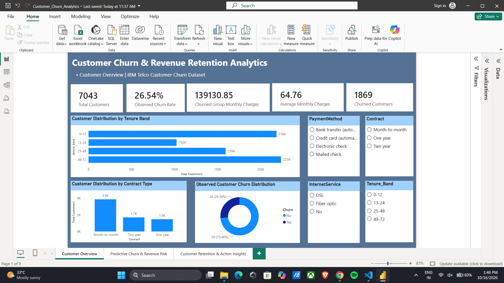
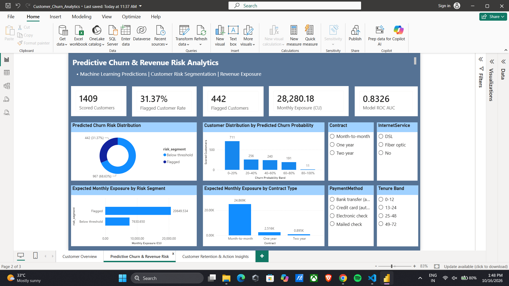
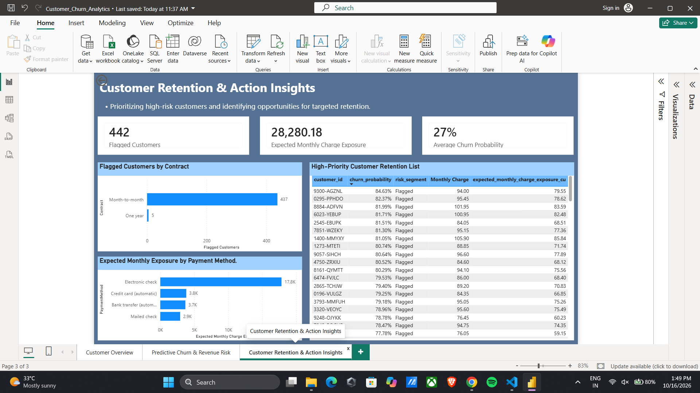

# Customer Churn Prediction & Revenue Retention Analytics

An end-to-end Data Science and Business Analytics project that analyzes customer churn, predicts churn risk using machine learning, and presents customer retention insights through interactive Power BI dashboards.

The project integrates **Python, SQL, Machine Learning, and Power BI** to transform customer data into actionable business insights.

## Project Objectives

- Analyze customer characteristics and historical churn patterns.
- Build a machine learning model to predict customer churn probability.
- Identify customers with elevated churn risk.
- Analyze monthly charge exposure associated with predicted churn.
- Develop interactive dashboards for customer analytics.
- Support data-driven customer retention decisions.

## Technology Stack

| Category | Technologies |
|---|---|
| Programming Language | Python |
| Data Analytics | Pandas, NumPy |
| Machine Learning | Scikit-learn, Logistic Regression |
| Database | SQLite, SQL |
| Business Intelligence | Microsoft Power BI |
| Data Visualization | Matplotlib, Seaborn |
| Model Serialization | Joblib |
| Development Tools | VS Code, Git, GitHub |

## Dataset

**Dataset:** IBM Telco Customer Churn sample dataset

The dataset contains customer demographic information, subscription details, billing characteristics, and historical churn outcomes.

### Dataset Information

| Description | Value |
|---|---:|
| Total Customers | 7,043 |
| Training Records | 4,225 |
| Validation Records | 1,409 |
| Testing Records | 1,409 |
| Model Input Features | 19 |

### Key Features

- Customer tenure
- Monthly charges
- Total charges
- Contract type
- Payment method
- Internet service
- Online security
- Tech support
- Streaming services
- Demographic characteristics

**Target variable:** Customer churn

## Project Workflow

1. Dataset acquisition and validation
2. Data cleaning and preprocessing
3. Exploratory Data Analysis (EDA)
4. SQLite database integration
5. SQL-based customer analytics
6. Feature engineering
7. Machine learning model training
8. Model evaluation and threshold selection
9. Customer churn risk scoring
10. Power BI dashboard development
11. Customer retention analysis

## Exploratory Data Analysis

Performed exploratory analysis to understand customer churn patterns and identify important characteristics associated with customer attrition.

The analysis includes:

- Overall churn distribution
- Churn by contract type
- Churn by customer tenure
- Churn by payment method
- Monthly charges by churn status

EDA charts are available in:

`reports/figures/`

## SQL Database and Analytics

The project uses SQLite for structured customer data storage and analytical querying.

### Database Tables

| Table | Records |
|---|---:|
| customers_clean | 7,043 |
| model_predictions | 1,409 |
| model_evaluation | 7 |
| data_quality_audit | 0 |

### SQL Operations

- Data filtering
- Aggregations
- Grouping
- Customer segmentation
- Churn analysis
- Analytical reporting

SQL scripts are available in the `sql/` directory.

## Machine Learning Model

Developed a Logistic Regression classification model using Scikit-learn to estimate customer churn probabilities.

### Model Configuration

| Parameter | Value |
|---|---|
| Algorithm | Logistic Regression |
| Model Version | logistic_regression_v1 |
| Classification Threshold | 0.40 |
| Threshold Selection | Validation F1-score |
| Random State | 42 |
| Training Records | 4,225 |
| Validation Records | 1,409 |
| Test Records | 1,409 |

### Model Performance

Performance evaluated on the held-out test dataset.

| Metric | Result |
|---|---:|
| Accuracy | 77.29% |
| Precision | 56.11% |
| Recall | 66.31% |
| F1-Score | 60.78% |
| ROC-AUC | 0.8326 |
| PR-AUC | 0.6224 |
| Brier Score | 0.1414 |

### Confusion Matrix Results

| Classification Outcome | Count |
|---|---:|
| True Positives | 248 |
| True Negatives | 841 |
| False Positives | 194 |
| False Negatives | 126 |

The model correctly identified approximately 66.31% of actual churners in the held-out test set.

Model performance is based on a random test split and does not guarantee future production performance.

The trained model is stored in:

`models/churn_pipeline.joblib`

Model metadata is available in:

`models/model_metadata.json`

## Power BI Dashboards

Developed three interactive Power BI dashboards for descriptive, predictive, and retention-focused customer analytics.

The Power BI report is available at:

`powerbi/Customer_Churn_Analytics.pbix`

### Dashboard 1 — Customer Overview



This dashboard provides an overview of customer distribution, historical churn patterns, subscription characteristics, and billing information.

**Key Results**

| KPI | Value |
|---|---:|
| Total Customers | 7,043 |
| Churned Customers | 1,869 |
| Observed Churn Rate | 26.54% |
| Average Monthly Charges | 64.76 CU |
| Monthly Charges of Churned Customers | 139,130.85 CU |

**Dashboard Features**

- Customer churn KPI cards
- Churn distribution analysis
- Contract-based customer analysis
- Customer tenure analysis
- Interactive customer filters

### Dashboard 2 — Predictive Churn & Revenue Risk



This dashboard presents machine learning churn predictions and analyzes estimated monthly charge exposure across customer risk segments.

**Key Results**

| KPI | Value |
|---|---:|
| Scored Customers | 1,409 |
| Flagged Customers | 442 |
| Flagged Customer Rate | 31.37% |
| Expected Monthly Charge Exposure | 28,280.18 CU |
| Model ROC-AUC | 0.8326 |

**Dashboard Features**

- Predicted churn risk distribution
- Churn probability distribution
- Expected monthly exposure by risk segment
- Exposure by contract type
- Interactive customer filtering

The monthly exposure metric represents an analytical estimate, not confirmed future revenue loss.

### Dashboard 3 — Customer Retention & Action Insights



This dashboard focuses on identifying high-risk customers and supporting customer retention prioritization.

**Key Results**

| KPI | Value |
|---|---:|
| Flagged Customers | 442 |
| Expected Monthly Charge Exposure | 28,280.18 CU |
| Average Churn Probability | Approximately 27% |

**Dashboard Features**

- Flagged customers by contract type
- Expected monthly exposure by payment method
- High-priority customer retention table
- Customer-level churn probabilities
- Risk segmentation and monthly charge analysis

The priority table helps identify customers for potential retention outreach based on predicted risk.

## Customer Retention Recommendations

Based on the customer analytics and machine learning predictions, the following business actions could be considered.

### 1. Prioritize High-Risk Customers

Identify customers flagged by the model and prioritize them for further review and targeted retention outreach.

### 2. Review Month-to-Month Contracts

Investigate suitable loyalty offers, renewal incentives, or longer-term contract options for customers with elevated churn risk.

### 3. Analyze Payment Methods

Examine churn risk and expected monthly charge exposure across payment methods to identify potential retention opportunities.

### 4. Prioritize Revenue Exposure

Consider both predicted churn probability and customer monthly charges when determining retention priorities.

### 5. Measure Retention Effectiveness

Evaluate retention campaigns through controlled experiments before reporting actual improvements in churn rates or revenue.

**Note:** These recommendations are proposed business actions. The project does not contain observed retention campaign outcomes or proven revenue savings.

## Project Structure

```text
CustomerChurnAnalytics/
|
|-- data/
|   |-- raw/
|   |-- processed/
|   |-- exports/
|
|-- database/
|   |-- customer_churn.db
|
|-- models/
|   |-- churn_pipeline.joblib
|   |-- model_metadata.json
|
|-- notebooks/
|
|-- powerbi/
|   |-- Customer_Churn_Analytics.pbix
|
|-- reports/
|   |-- figures/
|   |-- dashboard_screenshots/
|   |   |-- customer_overview.png
|   |   |-- predictive_churn.png
|   |   |-- customer_retention.png
|   |-- model_evaluation.md
|
|-- sql/
|   |-- analytical_queries.sql
|   |-- reporting_views.sql
|   |-- schema.sql
|
|-- src/
|   |-- churn_analytics/
|       |-- database.py
|       |-- download_data.py
|       |-- eda.py
|       |-- evaluate.py
|       |-- export_powerbi.py
|       |-- load_predictions.py
|       |-- preprocess.py
|       |-- score.py
|       |-- threshold_analysis.py
|       |-- train.py
|       |-- validate.py
|
|-- tests/
|
|-- .gitignore
|-- README.md
|-- requirements.txt
```

## Installation and Setup

### 1. Clone the Repository

```bash
git clone https://github.com/aryanmole8-tech/customer-churn-analytics.git
```

```bash
cd customer-churn-analytics
```

**Note:** The repository is currently private. GitHub authentication and repository access permissions are required.

### 2. Create a Python Environment

Use a compatible Python environment with the required dependencies.

### 3. Install Dependencies

```bash
python -m pip install -r requirements.txt
```

### 4. Explore the Project

- Python source files: `src/churn_analytics/`
- SQL queries: `sql/`
- Model evaluation: `reports/model_evaluation.md`
- Trained model: `models/`
- Interactive Power BI report: `powerbi/`

The Python modules implement different stages of the analytics pipeline. Review their execution requirements before running them.

### 5. Open Power BI Dashboards

1. Install Microsoft Power BI Desktop.
2. Open `powerbi/Customer_Churn_Analytics.pbix`.
3. Explore the three dashboard pages.

Some Power BI refresh operations may require updating local data source paths.

## Project Limitations

- The dataset is a fictional sample of telecom customers.
- Random train-validation-test splitting does not establish future forecasting accuracy.
- Predicted churn probabilities are not guaranteed to be perfectly calibrated.
- Model performance may differ on new customer populations.
- Monthly charge exposure is not equivalent to confirmed lost revenue.
- No observed retention campaign results or realized revenue savings are available.

## Author

**Aryan Mole**

Data Science & Data Analytics Portfolio Project

GitHub: https://github.com/aryanmole8-tech

## Project Status

**Development completed**

- Python data processing and analytics completed
- SQLite database developed
- Machine learning model trained and evaluated
- Customer risk scores generated
- Three Power BI dashboards developed
- GitHub repository initialized and uploaded
- Dashboard screenshots added to project documentation

Reproducibility and publication-permission checks may require further verification.
